# Vibe-code audit

What makes an app read as "prompted into existence", how ATLAS measured
against each tell, and what changed. The goal was to keep the existing premium
design (palette, Geist, dark-first surfaces, hero layouts, hairline edges,
radius scale) and remove only the fingerprints that every generated UI shares.

## Sources

- Developers Digest, [AI Design Slop: 16 patterns](https://www.developersdigest.tech/blog/ai-design-slop-and-how-to-spot-it)
- Pixelslop, [AI Slop Pattern Catalog](https://cdn.jsdelivr.net/npm/pixelslop@0.3.8/dist/skill/resources/ai-slop-patterns.md)
- Impeccable, [The visible tells of AI design](https://www.impeccable.style/slop)
- The Fountain Institute, [7 signs a UI has been vibe coded](https://www.thefountaininstitute.com/blog/signs-vibe-coded-ui)
- prg.sh, [Why your AI keeps building the same purple gradient website](https://prg.sh/ramblings/Why-Your-AI-Keeps-Building-the-Same-Purple-Gradient-Website)
- Sinton, [How to spot a vibe coded website](https://www.sinton.agency/blog/how-to-spot-a-vibe-coded-website)

No single tell proves anything. Each one is a signal that a default was
accepted rather than a choice made, and they count when several stack up.

## The checklist

Status: **Fixed** = changed in this pass. **Kept** = present on purpose, with
the reason. **Clear** = ATLAS never had it.

### Color and light

| Tell                                                     | ATLAS before                                                                                                       | Status                                                                                                                                           |
| -------------------------------------------------------- | ------------------------------------------------------------------------------------------------------------------ | ------------------------------------------------------------------------------------------------------------------------------------------------ |
| Gradient text on headings and metrics                    | Every page title (`PageHeading`) and 11 hero figures faded foreground → 55–65% via `bg-clip-text`                  | **Fixed**: solid `text-foreground` (runway keeps `text-destructive` when short)                                                                  |
| Multicolored glow orbs ("two blobs in opposite corners") | 14 heroes each had a primary orb plus a second orb in cyan, sky, violet, indigo, teal or emerald, changed per page | **Fixed**: one shared `HeroBackdrop` with a single primary light from the top right                                                              |
| Copy-pasted hero recipe with only the colors changed     | The same five-layer backdrop pasted into 14 files                                                                  | **Fixed**: one component, `src/components/shared/hero-backdrop.tsx`                                                                              |
| Decorative grid background                               | Masked `atlas-grid` behind 12 heroes and Focus mode                                                                | **Fixed**: removed, along with the unused CSS                                                                                                    |
| Aurora background                                        | Every app page sat under a three-color aurora (brand blue + `#38bdf8` + `#6366f1`)                                 | **Fixed**: one soft brand-blue light                                                                                                             |
| Purple / cyan "AI palette"                               | Violet and cyan used as glow and gradient tints                                                                    | **Fixed** for decoration. **Kept** in categorical palettes (goal areas, career stages, timeline modules), where many distinct hues carry meaning |
| Gradient icon tiles with colored glow shadow             | Capture, Analyst (×2) and the Settings avatar used primary → violet/emerald fills with a primary glow              | **Fixed**: the tinted tile Dayline already used (`bg-primary/12` + ring)                                                                         |
| Neon glows on dark                                       | Dayline load arc drop-shadow, glowing first route segment, glowing target icon                                     | **Fixed**: removed                                                                                                                               |
| Small decorative orbs inside cards                       | Goals empty state, Tasks overview, Reminders, Export card                                                          | **Fixed**: removed (the card's top wash stays)                                                                                                   |
| Pure `#000` / `#fff` backgrounds                         | Theme uses tinted `#070a0f` / `#f4f7fb`                                                                            | **Clear**                                                                                                                                        |
| Tinted button shadow                                     | Primary buttons carry a soft brand-tinted shadow                                                                   | **Kept**: documented in the design system as tactile depth, and subtle                                                                           |

### Surfaces and effects

| Tell                                      | ATLAS before                                                                          | Status                                                                                                                                                                             |
| ----------------------------------------- | ------------------------------------------------------------------------------------- | ---------------------------------------------------------------------------------------------------------------------------------------------------------------------------------- |
| Cursor-following "spotlight card"         | Every hero and many cards lit up under the mouse (`SpotlightArea` + `data-spotlight`) | **Fixed**: removed the effect, its pointer listener and every `data-spotlight` hook                                                                                                |
| Glassmorphism everywhere                  | `backdrop-blur` on 62 elements, many sitting on an opaque page                        | **Fixed** on 21 in-flow toolbars, pills, chips and the Dayline card. **Kept** where blur has a job: modal scrims, sticky bars, popovers, chips on colored wallet cards, Focus mode |
| One-sided accent stripe on a rounded card | Success toast had a 3px left stripe                                                   | **Fixed**: removed. **Kept** for blockquotes and Signals severity, where the stripe is a real state                                                                                |
| Extreme corner radius                     | Heroes at 28–32px, cards at 24px                                                      | **Kept**: radius scales with surface size, which is the recommended fix                                                                                                            |
| Hairline border + wide shadow             | Light-catching `edge` hairline on cards                                               | **Kept**: it is the product's signature edge and subtle                                                                                                                            |
| Film grain                                | 7% grain over the page light                                                          | **Kept**: barely visible and not a recognised tell                                                                                                                                 |

### Typography

| Tell                       | ATLAS before                                                                                  | Status                                                                                                                                                                                                                                    |
| -------------------------- | --------------------------------------------------------------------------------------------- | ----------------------------------------------------------------------------------------------------------------------------------------------------------------------------------------------------------------------------------------- |
| Pill badge above the H1    | Every page opened with an uppercase, letter-spaced, blurred pill                              | **Fixed**: a quiet label, with icon in brand blue and sentence-case text. Same content, same place                                                                                                                                        |
| Crushed letter spacing     | Titles at −0.05em, hero figures at −0.06em                                                    | **Fixed**: loosened to −0.035em and −0.045em                                                                                                                                                                                              |
| All-caps micro labels      | 84 tracked uppercase section labels and eyebrows across the app ("WHERE THEY STAND", "PULSE") | **Fixed**: sentence case, one size step up so they keep their weight. **Kept** for data annotations: month and weekday abbreviations on date tiles, radar axis labels, sticky table column headers, and the printed label on wallet cards |
| Inter / Geist default font | Geist                                                                                         | **Kept**: it is the brand face, and Settings already offers 20+ alternatives                                                                                                                                                              |
| Monospace for "tech vibes" | `font-mono` renders the UI face with tabular numerals                                         | **Clear**: no terminal look                                                                                                                                                                                                               |
| Serif italic accent word   | Landing hero ("Choose what moves.")                                                           | **Kept**: a documented landing brand choice; the app itself never does this                                                                                                                                                               |

### Iconography

| Tell                                 | ATLAS before           | Status                                                                                                                                                                                              |
| ------------------------------------ | ---------------------- | --------------------------------------------------------------------------------------------------------------------------------------------------------------------------------------------------- |
| ✨ Sparkles as the "AI / magic" icon | 13 uses across 9 files | **Fixed**: each swapped for an icon that says what it does (`PenLine`, `ScanText`, `MessageSquareText`, `Lightbulb`, `Waypoints`, `ThumbsUp`, `Sprout`, `Flag`, `ListPlus`, `IdCard`, `FileSearch`) |
| Emoji as icons                       | None                   | **Clear**                                                                                                                                                                                           |

### Motion

| Tell                               | ATLAS before                                             | Status                                                                                                                     |
| ---------------------------------- | -------------------------------------------------------- | -------------------------------------------------------------------------------------------------------------------------- |
| Pulsing status dot on static state | Signals "Checked 10:42" pinged forever                   | **Fixed**: static dot. **Kept** where something is actually running (Focus timer, Analyst steps, pending saves, skeletons) |
| Hover lift / zoom on cards         | 9 surfaces rose 1–2px; the pattern matrix scaled to 105% | **Fixed**: removed. Hover still changes ring, shadow and color                                                             |
| `transition-all`                   | 2 uses                                                   | **Fixed**: named properties                                                                                                |
| Bouncy / elastic easing            | All curves are ease-out (`0.22, 1, 0.36, 1`)             | **Clear**                                                                                                                  |
| Marquee, blinking cursor           | None                                                     | **Clear**                                                                                                                  |

### Copy

| Tell                                        | ATLAS before                           | Status                                                                                                                           |
| ------------------------------------------- | -------------------------------------- | -------------------------------------------------------------------------------------------------------------------------------- |
| Em dash in every other sentence             | 13 on the landing page, 6 in app prose | **Fixed**: commas, full stops and colons. Em dash kept only as the "no value" placeholder in tables, which is correct typography |
| Hype words (seamless, unlock, supercharge…) | None found                             | **Clear**                                                                                                                        |
| Generic CTA ("Get started", "Learn more")   | Landing header "Get started"           | **Fixed**: "Create account"                                                                                                      |
| Lorem ipsum / "Coming soon"                 | None                                   | **Clear**                                                                                                                        |

### Repository and technical

| Tell                                   | ATLAS before                                                                      | Status                                                                |
| -------------------------------------- | --------------------------------------------------------------------------------- | --------------------------------------------------------------------- |
| Builder badges, template favicon or OG | Custom icons, OG image and manifest                                               | **Clear**                                                             |
| Leftover AI-tool folders in the repo   | `.codex-audits/`, `.codex-remote-attachments/`, `.superdesign/`, root screenshots | **Kept**: not shipped to users. Worth tidying if the repo goes public |
| Missing a11y / mobile breakage         | Axe checks, 44px targets, safe areas                                              | **Clear**                                                             |

## Follow-ups (done in a second pass)

- **All-caps labels.** Section labels and eyebrows are sentence case. See the
  typography table for the data annotations that keep their caps.
- **Landing stat row** ("Systems 5 · Daily route 1 · Spreadsheets 0").
  Removed. The numbers were symbolic, and the paragraph above already makes
  the point.
- **Company monograms** in Career. The glossy gradient pairs (including
  violet → purple and fuchsia → violet) are now the app's tinted tile: a soft
  wash with initials in the same hue. There are still eight hues, so each
  company keeps a stable color, with no violet or fuchsia.

## Round 3: app-level tells

The first two passes followed landing-page catalogs. This pass used sources
about whole apps: microcopy, states, emails, component defaults and motion.

### More sources

- SaaS UI Design, [SaaS UI looks AI-generated? 7 fixes](https://www.saasui.design/blog/saas-ui-looks-ai-generated)
- VibeMole, [How to avoid building apps that look vibe coded](https://vibemole.com/resources/avoid-vibecoded-app-design)
- Is My App Slop, [Design tips to make your vibe-coded app look real](https://ismyappslop.com/resources/design-tips-to-make-your-vibe-coded-app)
- Axon Build, [How to tell if an app was vibe coded](https://axonbuild.com/blog/how-to-tell-if-an-app-was-vibe-coded/)
- DEV Community, [Your vibe-coded app looks ugly](https://dev.to/kiwibreaksme/your-vibe-coded-app-looks-ugly-heres-what-i-did-about-it-2nb4)
- Claude Skills, [AI writing detection](https://claudeskills.info/skills/mike-coulbourn/claude-vibes/ai-writing-detection/)

### Checklist

| Tell                                                          | ATLAS before                                                                                    | Status                                                                                                                                                                 |
| ------------------------------------------------------------- | ----------------------------------------------------------------------------------------------- | ---------------------------------------------------------------------------------------------------------------------------------------------------------------------- |
| Stock auth emails                                             | Supabase's default "Confirm your signup" emails                                                 | **Fixed**: branded confirmation, recovery and email-change templates in `supabase/templates/`, wired in `config.toml`, with hosted setup steps in `docs/deployment.md` |
| Tutorial placeholder names ("Acme")                           | Capture examples and the career form placeholder                                                | **Fixed**: local examples (Canva, Globe Telecom, "call Mika") that match the landing demo                                                                              |
| Generic microcopy ("Welcome back", "…successfully")           | Login eyebrow, password-change message                                                          | **Fixed**: "Log in", "Password changed." Errors already name what failed, and empty states teach the next step                                                         |
| Title Case headings                                           | "Your Day, Mapped." on Today                                                                    | **Fixed**: "Your day, mapped."                                                                                                                                         |
| Formula phrases ("at a glance", "in one place", "Ready to…?") | Today, History, Settings, launch screen                                                         | **Fixed**: rewritten to say what is there                                                                                                                              |
| Slogan contrasts ("not X, Y" used for punch)                  | Reviews prompt, two landing lines                                                               | **Fixed**. **Kept** where "X, not Y" is a precise disclaimer ("associations, not causes", "estimates, not guarantees")                                                 |
| Repeated kicker labels                                        | "Insight engine", "Learning system", "Opportunity pipeline", "ATLAS Graph"                      | **Fixed**: factual descriptors ("Changes and risks", "Spaced review", "Applications", "Goals / Connections")                                                           |
| Vague page descriptions                                       | Reviews ("a quiet place to notice…"), Timeline ("…shaping your life")                           | **Fixed**: say what the page holds                                                                                                                                     |
| Glossy gradient icon tiles                                    | Analyst, Capture and Settings tiles faded hue → transparent with a white inset highlight        | **Fixed**: one flat tinted tile everywhere                                                                                                                             |
| Glowing gradient chat UI                                      | Analyst send button and question bubbles glowed blue                                            | **Fixed**: solid primary with the standard button shadow                                                                                                               |
| Off-scale values                                              | Radii at 18, 22 and 22.4px; the same type size written as px and rem                            | **Fixed**: snapped to the 12–32px radius scale; one unit per size                                                                                                      |
| Long entrance motion                                          | Chart bars and meters took 800–1100ms                                                           | **Fixed**: 400–700ms, still transform-only and reduced-motion aware                                                                                                    |
| Floating chat bubble                                          | None. The phone-only "+" buttons are native create actions above the bottom nav                 | **Clear**                                                                                                                                                              |
| Default chart styling                                         | Charts use theme tokens and custom tooltips                                                     | **Clear**                                                                                                                                                              |
| Identical KPI tiles                                           | Today's situation tiles already differ (urgent state, progress ring, payday context)            | **Clear**                                                                                                                                                              |
| Missing empty, loading and error states                       | Skeletons, specific empty states with actions, an error page that says records were not changed | **Clear**                                                                                                                                                              |
| Default title, favicon, metadata                              | Per-page titles, custom icons, OG image, manifest                                               | **Clear**                                                                                                                                                              |
| Console errors                                                | None on the pages rendered for this pass                                                        | **Clear**                                                                                                                                                              |

### Deliberately kept

- **The same hero shape on every module** (big figure, label, supporting
  tiles). Sources call "every screen is a dashboard" a tell, but each hero
  answers that module's own question, and the hero is the core of the
  premium design.
- **Inset tiles inside cards.** They are flat, sunken wells with a hairline
  ring, not stacked shadowed cards.
- **Landing mono labels and the Manila coordinates.** These are part of the
  landing's editorial system and sense of place, not the app's.
- **The "Debt Payment" category name.** It is stored data that code matches
  by name, so renaming it needs a data migration.

## Round 4: the signed-in pages, against reference products

Rounds 1–3 were judged from code and from the pages that render without an
account. This round ran the real app against a local Supabase with fictional
data, screenshotted all 25 signed-in pages, and compared them with products
known for restraint.

### Reference products

- Linear, [How we redesigned the Linear UI](https://linear.app/now/how-we-redesigned-the-linear-ui) and [Behind the latest design refresh](https://linear.app/now/behind-the-latest-design-refresh): chrome recedes, fewer and smaller icons, colored icon backgrounds removed, fewer separators.
- Vercel, [Geist materials](https://vercel.com/geist/materials) and [typography](https://vercel.com/geist/typography): 6px base radius, 12px cards and menus, 16px only for full-screen layers.
- Copilot Money, [design breakdown](https://blakecrosley.com/de/guides/design/copilot-money): surfaces separated by tonal steps rather than borders; color reserved for data.
- Mercury and Stripe dashboards: small page titles, thin hairlines, dense lists.

### What every page shared

Every module opened with the same template: icon-and-label kicker, a 52px
title, a slogan description, then a glowing hero card with a colored kicker,
a 96px number with a word beside it, a status pill, an "Up next" box, a
multi-color bar and identical stat tiles, followed by lists where each group
sat in its own bordered card. Inside cards, bordered boxes sat in bordered
boxes, and most headings carried a tinted icon tile.

### Changes

| Area              | Before                                                                                                                 | After                                                                          |
| ----------------- | ---------------------------------------------------------------------------------------------------------------------- | ------------------------------------------------------------------------------ |
| Light             | Hero glow on 13 surfaces, page-wide light, film grain, colored top washes on 6 panels                                  | None. Surfaces are flat                                                        |
| Edges and shadows | Gradient "light-catching" edge, 22–90px soft shadows on 37 cards, blue glows on buttons and selected cards             | Uniform 1px hairline, hairline-level shadow, elevation only on floating layers |
| Radius            | Cards and heroes at 24–32px                                                                                            | 16px cards, 12px inner wells                                                   |
| Nested boxes      | 51 bordered or ringed tiles inside cards                                                                               | Borderless tonal wells; interactive tiles keep their ring                      |
| Page titles       | 52px slogan display, icon + kicker above                                                                               | 28px title; eyebrow only for trails, greeting with date, or cadence            |
| Hero figures      | Up to 96px with −0.06em tracking                                                                                       | Up to 52px with −0.03em                                                        |
| Kicker labels     | Blue on 46 labels across 24 cards and heroes                                                                           | Muted                                                                          |
| Icon tiles        | Tinted squares beside most headings                                                                                    | 16px muted glyph in headings; neutral squares where a tile helps scanning      |
| Tabs              | Pill tracks with icons and count badges (Money, Tasks)                                                                 | Underline tabs, plain counts                                                   |
| Pills             | Dates, reasons, payday and percentages as pills                                                                        | Plain text, red or amber only when it matters; pills kept for status           |
| Stat rows         | Four identical stat cards on Goals                                                                                     | One summary strip                                                              |
| Transactions      | One card per day                                                                                                       | One list with day sub-headers                                                  |
| Account cards     | Glossy gradient, stripes, watermark icon, uppercase label                                                              | Flat provider color, sentence-case label                                       |
| Ordered scales    | Seven unrelated hues for career stages and memory strength                                                             | One blue that deepens, semantic colors only at the ends                        |
| Today             | Glowing NOW pill, uppercase NOW/NEXT/LATER, 40px task title, quote card with texture, giant quote mark and meta footer | Solid "Now" badge, sentence case, 28px title, plain quote card                 |

The rules behind these changes are now in `.superdesign/design-system.md`,
so new screens start from them.

### Deliberately kept

- Progress rings and meters: they show real progress, and the text beside
  them carries the same figure.
- The diagonal hatching in History's series chart: it is the legend for
  "partial" coverage.
- Segmented filters (All / Expenses / Income, List / Board) and Kanban
  column counts: established controls.
- The stacked-card shadow on phones: it separates overlapping account cards.

## Evidence

Same component, same data, dark theme, HEAD on the left and this pass on the
right.

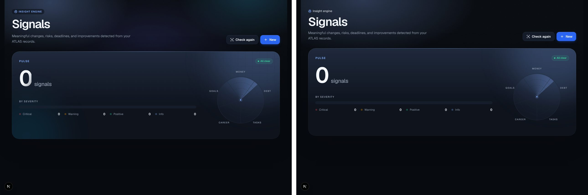
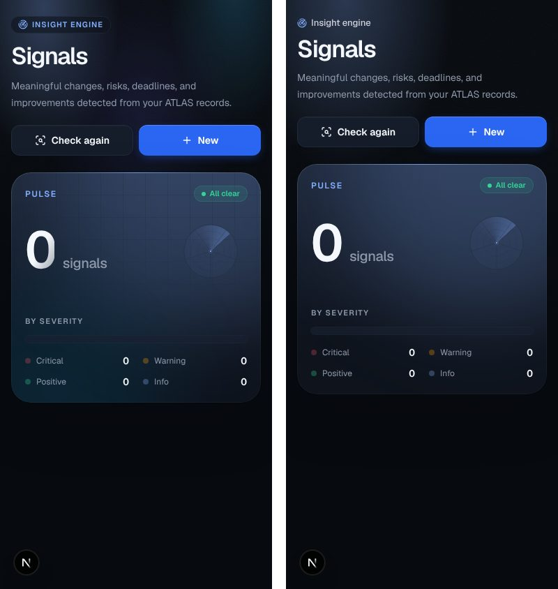
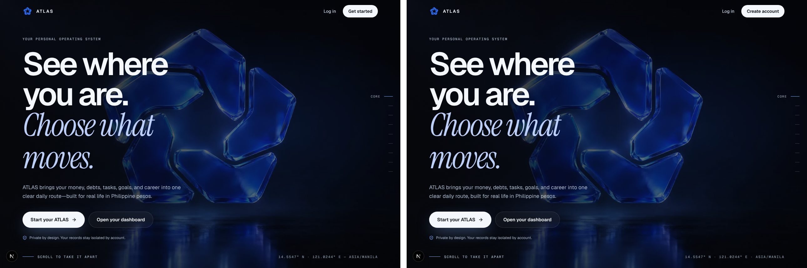

Second pass: section labels before (top) and after, company marks in dark and
light, and the landing "problem" chapter without the stat row.

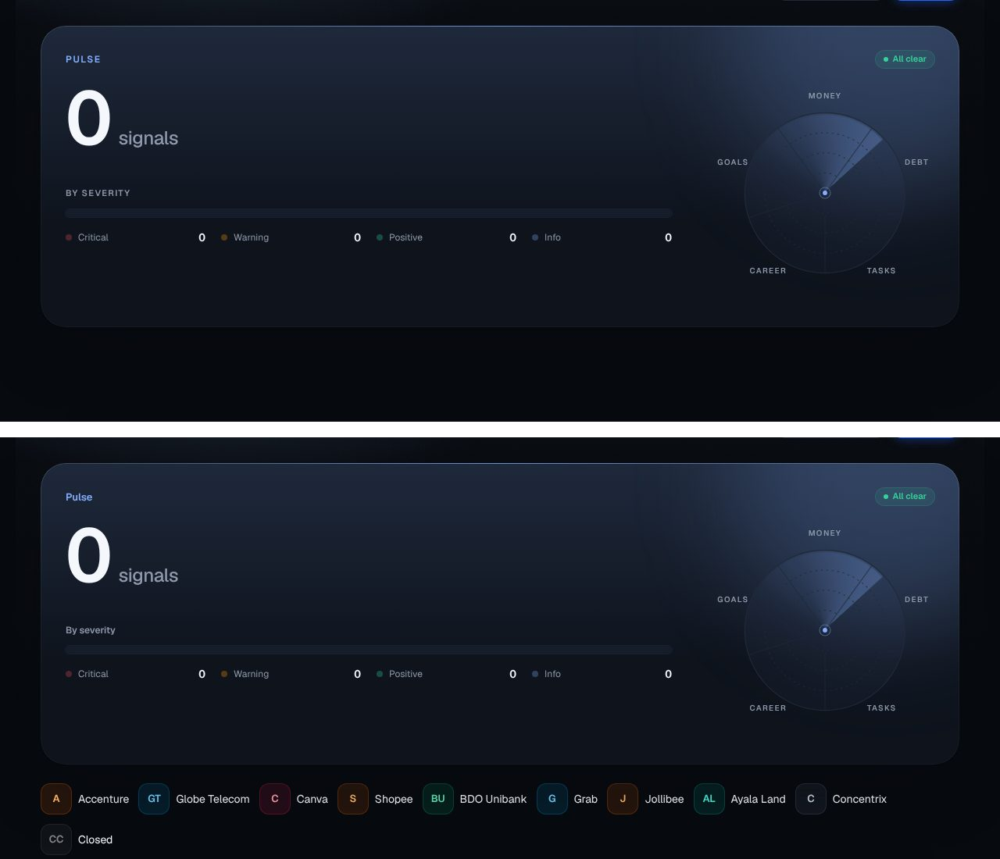
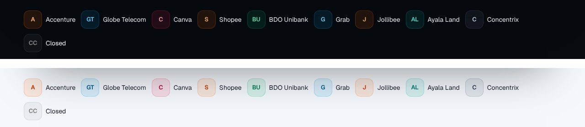
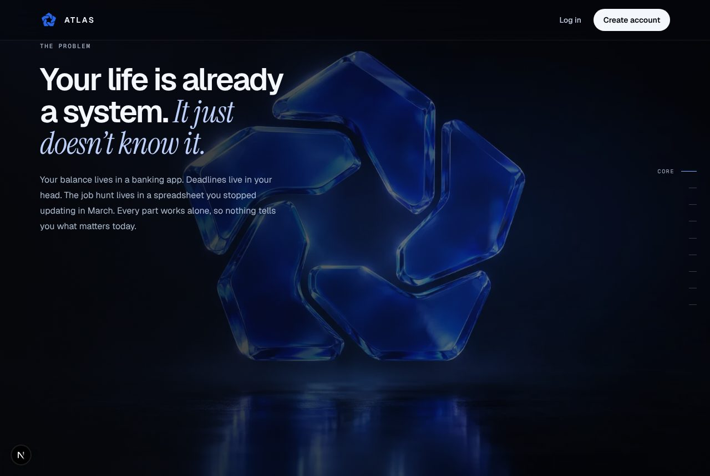

Round 3: flat icon tiles, the login screen, and the branded auth emails.

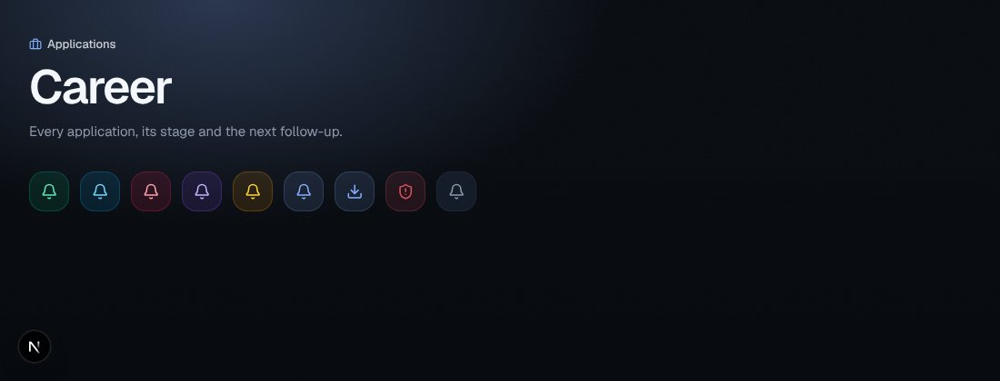
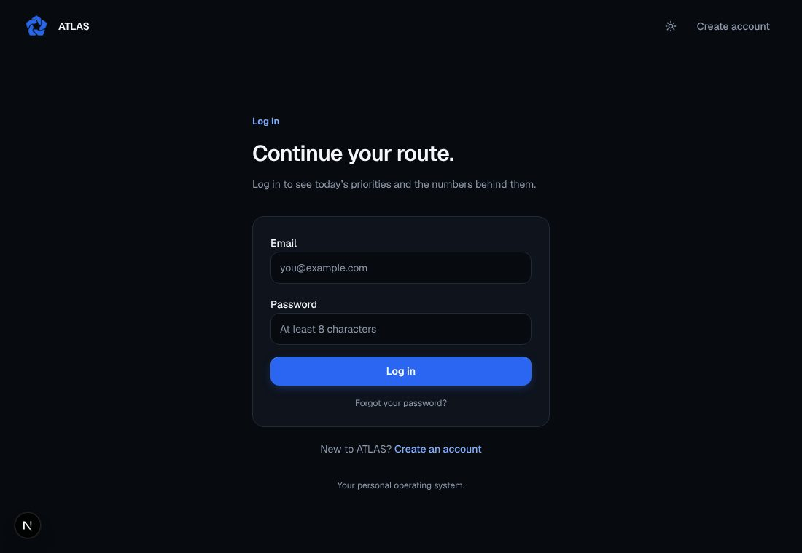
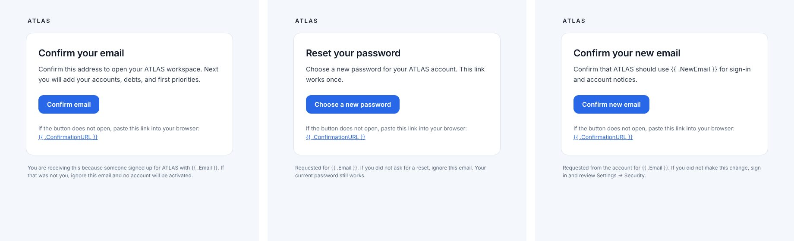

Round 4: signed-in pages, before (left) and after (right), dark theme at
1440px with the same fictional data.

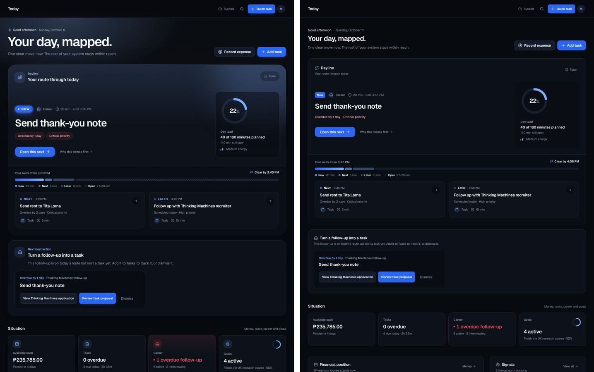
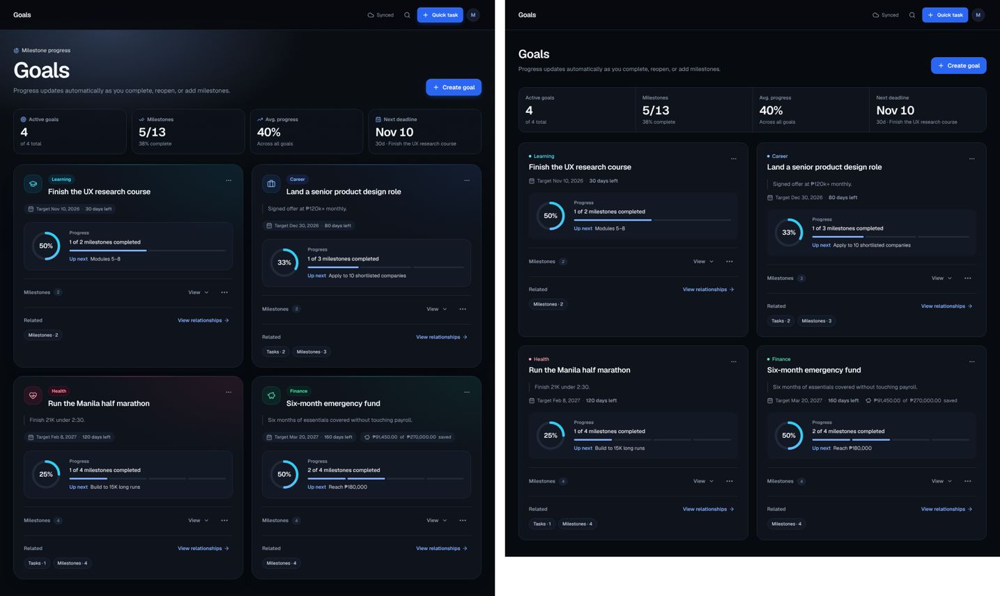
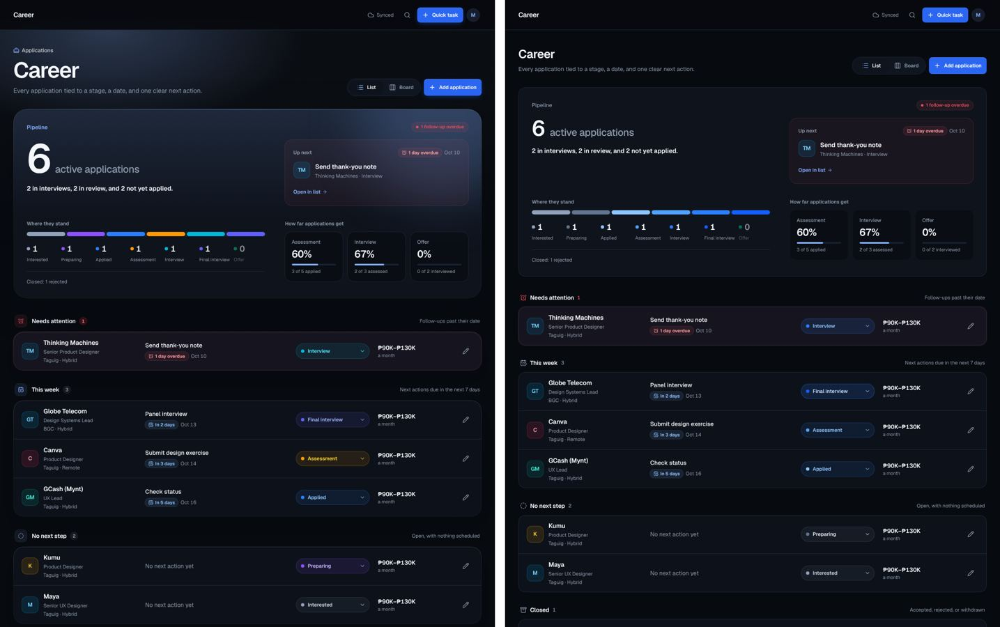
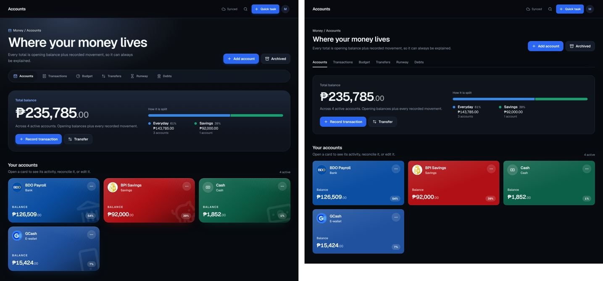
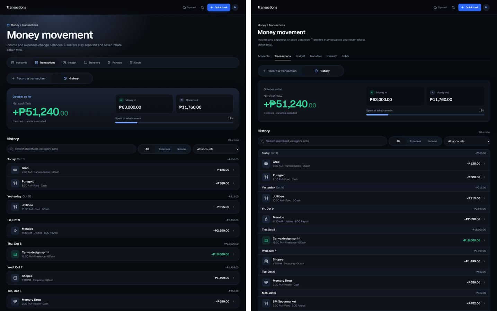
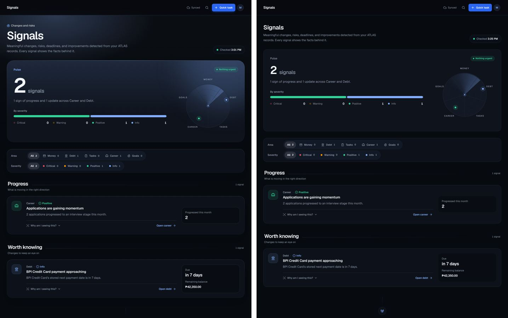
